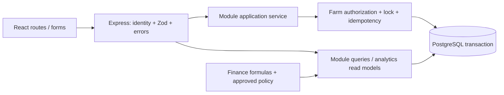

# Arsitektur OpSmart

## Stack dan batas fase

Satu package TypeScript strict: React 19 + Vite 7 + React Router 7 di client, Express 5
di server, PostgreSQL 17+ lewat pg 8, Zod 4, Node test runner + tsx + PGlite untuk tes.
Prettier mengatur format. Tidak ada ORM, global state library, microservice, event bus,
analytics database, queue atau cache server. Versi patch aktual ada di lockfile.

SQL migrations dipilih agar constraint dan transaction boundary terlihat langsung.
PGlite hanya dependency pengujian; runtime produksi menggunakan PostgreSQL melalui pg.
Next.js/ORM adalah alternatif yang masuk akal, tetapi tidak diperlukan untuk shell SPA
dan contoh transaksi eksplisit ini. Pilihan ini tercatat sebagai keputusan teknis Phase 1.

## Lapisan

UI mengirim intent, bukan saldo atau total terpercaya. API memvalidasi session, route,
body; service memeriksa relasi dan aturan domain. Semua write lintas modul memakai satu
Sql transaction. Query mengembalikan DTO, bukan row database secara sembarang.
Interaksi lokal memakai React state; halaman farm membaca DTO melalui API.

## Kepemilikan modul

| Modul     | Memiliki                                                 | Dependensi yang diizinkan                 |
| --------- | -------------------------------------------------------- | ----------------------------------------- |
| farms     | User mapping, farm, ownership                            | shared/server                             |
| farming   | Commodity, unit/subtype, cycle/subtype, cycle transition | farms                                     |
| schedules | Activity dan transisi aktivitas                          | farming                                   |
| inventory | Item, lot, ledger, consumption                           | farming/schedules untuk validasi konsumsi |
| products  | Definisi produk, grade, satuan, metadata harga           | inventory, farming                        |
| harvest   | Harvest + outputs; orkestrasi lot dan STOCK_IN           | farming, products, inventory              |
| sales     | Sale, lines; orkestrasi STOCK_OUT                        | products, inventory                       |
| finance   | Raw cost, kebijakan valuasi/alokasi, kalkulator          | query sumber operasional                  |
| analytics | Query agregasi dan DTO dashboard                         | semua read contracts; finance formulas    |

Jangan mengimpor client ke backend. Client hanya menggunakan shared/domain dan DTO.
`ledger.deduct` adalah helper transaksi internal, bukan service publik; pemanggil harus
memegang lock farm. Hindari cycle dependency modul dengan parameter id/DTO dan Sql dari
orkestrator. Jangan membangun repository generik atau service base class.

## Data, uang dan satuan

FarmUnit adalah induk identitas fisik; Pond/Coop/GrowingArea memuat atribut khusus.
FarmingCycle memuat relasi, tanggal dan status; FishCycle/ChickenCycle/CropCycle memuat
populasi/varietas/umur. Parent dan subtype dibuat atomik. Composite type FK mencegah
subtype yang salah; service harus memastikan tepat satu subtype dibuat. Belum ada aturan
agronomis tentang banyaknya siklus aktif per unit; jangan menambah larangan sepihak.

Quantity: numeric(18,3) di DB, string decimal di API, BigInt skala 1000 pada perhitungan.
Input API dibatasi 12 digit utuh dan 3 desimal. KG/G/L/ML/UNIT/HEAD/SEED adalah enum.
Satu item memiliki satu base unit; layanan tidak mengonversi otomatis. UNIT/HEAD/SEED
harus bilangan bulat. Berat KG terpisah dari jumlah HEAD pada harvest output.

Money: IDR tunggal, 1 rupiah = 100 minor units. bigint di PostgreSQL, string integer di
JSON, BigInt di server. UI formatter hanya untuk tampilan. Harga input memakai maksimal
16 digit; hasil dicek terhadap batas bigint DB. Total per baris = half-up(quantity ×
unitPriceMinor), pembulatan dilakukan sekali ke minor unit; total transaksi adalah
penjumlahan total baris. Aturan cash rounding ke rupiah penuh belum diputuskan.
Metadata harga bukan pengakuan revenue. Tidak ada multi-currency.

Tanggal budidaya/panen/penjualan memakai SQL date; jadwal/audit memakai timestamptz.
Farm timezone default Asia/Jakarta untuk tampilan; timestamp API harus ISO dengan offset.
ID random UUID dari node:crypto; external auth_subject hanya identifier, tanpa password.

## Transaksi dan retry

`command(db, context, operation, key, parsedInput, work)`:

1. BEGIN READ COMMITTED, validasi actor dan farm.
2. SELECT farm melalui farm_membership WHERE id dan actor anggota aktif, lalu FOR UPDATE;
   tidak ada hasil -> FORBIDDEN.
3. Cari receipt (farm, operation, key). Hash sama -> replay response; berbeda -> CONFLICT.
4. Jalankan semua write dan validasi saldo setelah lock.
5. Simpan response JSON/hash/actor pada receipt, COMMIT. Error apa pun -> ROLLBACK.

Hash berasal dari body yang sudah diparse Zod dan actor; array order dan bentuk decimal
termasuk identitas permintaan. Retry harus memakai payload parsed yang sama. Key tetap
untuk retry; intent baru memakai key baru. Receipt disimpan tanpa expiry pada MVP.
Tidak ada receipt untuk kegagalan, sehingga intent gagal dapat dicoba ulang setelah kondisi pulih.

Satu lock per farm adalah simplifikasi disengaja. Semua writer termasuk intake, koreksi,
harvest dan cancellation yang akan datang wajib mengikuti lock ini. Writer SQL bebas di
luar service tidak dijamin menjaga saldo nonnegatif. DB credential hanya milik backend;
DDL role dipisahkan dari runtime role sebelum produksi. Naikkan ke ordered per-lot locks
ketika contention terukur; jangan mencampur lock strategy pada separuh writer.

- Konsumsi: valid cycle ACTIVE + activity SCHEDULED/IN_PROGRESS -> consumption -> satu
  movement negatif per lot -> receipt. Menyelesaikan activity merupakan command terpisah.
- Panen (kontrak): harvest -> output per produk/grade -> lot per output -> STOCK_IN -> receipt.
  Semua berhasil bersama. Cycle tetap ACTIVE untuk panen parsial.
- Sale: product lookup -> server totals -> COMPLETED sale + items -> deduction per lot
  -> receipt. Payment dan refund POSTED dicatat terpisah; revenue diakui saat pembayaran
  diterima menurut `finance-mvp-v1`. HPP/COGS adalah projection yang menyertakan policy
  version dan sumbernya, bukan biaya mentah atau duplikasi nilai sale.

## Otorisasi dan error

Runtime `main.ts` memasang akun lokal dengan email/kata sandi. `003_local_auth.sql`
menyimpan kredensial dengan salt acak dan scrypt N=2^17,r=8,p=1, serta sesi server.
Token sesi acak 256 bit hanya berada di cookie HttpOnly; database menyimpan hash SHA-256
token. `auth_session.auth_subject` dihubungkan ke `app_user.auth_subject`, baru user ID
dipakai oleh service farm. Cookie produksi bernama `__Host-opsmart_session` dan memakai
Secure, Path=/, SameSite=Lax; development lokal memakai cookie tanpa Secure. Sesi
kedaluwarsa setelah tujuh hari dan dicabut saat logout. `GET /api/auth/me` mengembalikan
identitas dan token CSRF sesi untuk header `X-CSRF-Token`; semua mutasi juga wajib
memiliki Origin persis `APP_ORIGIN`. Respons API memakai `Cache-Control: no-store`.
Percobaan login per email dibatasi lima kegagalan dalam 15 menit, termasuk email yang
belum terdaftar. Error HTTP umum tidak memuat password, cookie atau token.

`ResolveIdentity` tetap default null -> 401 bila adapter tidak dipasang. Hanya entry
runtime yang memasang adapter; fixture test dapat menyuntik resolver terpisah.
Farm scope membatasi actor lewat farm_membership. Semua anggota memiliki akses data dan
aksi operasional/keuangan yang sama; hanya Owner yang dapat menambahkan anggota. `farm.owner_id`
tetap menjadi pemilik teknis. Semua foreign key tenant memakai farm_id dan actor dari
sesi terverifikasi; UUID farm lain tetap ditolak.

Farm registry sekarang mengunci app_user saat create (farm belum ada untuk dikunci),
memakai key sebagai farm.id, dan menyimpan receipt dalam transaksi yang sama. Update dan
archive menggunakan command() biasa. Arsip menandai archived_at/by, menyembunyikan farm
dari pilihan aktif, tetapi menjaga data untuk audit. Receipt command sebelum arsip masih
dapat di-replay setelah arsip; command baru ditolak. Pemilihan farm aktif disimpan lokal
di browser dan dicocokkan dengan daftar farm yang diikuti actor. Halaman Anggota
memungkinkan Owner menambah akun terdaftar melalui email dan mengeluarkan anggota
non-owner; pengeluaran memakai command idempoten dan langsung mencabut membership.
Layanan email eksternal tidak dipakai.

DomainError -> {error:{code,message}}. Zod/JSON invalid -> VALIDATION/422, missing identity
401, inaccessible farm 403, resource 404, stock/conflict 409, unexpected failure 500.
DB constraint/serialization errors tidak bocor ke UI. Tidak ada request body/cookie yang
ditulis ke log aplikasi. Logging terstruktur dengan request id adalah tugas hardening.
Browser memakai same-origin `/api`; tidak ada CORS lintas origin. Production wajib HTTPS
penuh di reverse proxy tepercaya, `NODE_ENV=production`, `APP_ORIGIN` HTTPS, pembatasan
request pada pendaftaran, dan kebijakan log proxy yang menyunting cookie/token. Email
belum diverifikasi dan alur pemulihan kata sandi belum tersedia.

## Extension points

- Recurrence: nanti tambah activity_series dan nullable series_id pada Activity plus unique
  (farm_id,series_id,scheduled_at). Satu activity tetap satu occurrence. Tidak ada scheduler kini.
- Waste/maggot: waste record dan batch maggot mencatat input, observasi, panen,
  pemakaian, dan sisa sebagai data operasional. Input batch mengambil satuan persis
  dari sumber limbah; observasi bebas tidak dipakai untuk menghitung metrik. Output
  tidak mengubah inventory kecuali melalui command eksplisit. Implementasi awal
  mengizinkan batch `COMPLETED` memposting sisa hasil ke lot item kategori `FEED` dengan
  satuan dasar sama. `STOCK_IN` dan provenance posting tersimpan atomik; penggunaan
  sebelumnya diperhitungkan. Transfer air kolam ikan → area tanam menyimpan liter secara
  manual tanpa mutasi stok/biaya. Ini bersama alur limbah → maggot → pakan mencakup dua
  jalur sirkular yang ditentukan sumber produk; jalur lain atau konversi satuan menunggu
  aturan produk yang spesifik.
- Members: akses seragam seluruh anggota sudah diterapkan pada boundary otorisasi tanpa
  matriks role; hanya Owner yang dapat menambah atau mengeluarkan anggota non-owner.
  `farm.owner_id` tetap menjadi pemilik teknis. Pengeluaran mencabut membership tanpa
  mengubah ledger atau actor historis.
- IoT: P3-01 menyediakan registry perangkat farm-scoped, token ingest yang disimpan
  sebagai hash, telemetry append-only, dan retensi 90 hari. P3-02 menambah config alert
  per versi/unit, episode dan transisi, evaluasi threshold di transaksi ingest, pemeriksa
  stale pada worker 60 detik, serta histori API/UI. Tidak memakai farm ledger lock,
  konversi unit, polling browser, atau hardware provider.
- AI/RAG: consume query/read contracts dengan farm authorization, bukan membaca komponen UI.
  RAG MVP mengindeks pengetahuan statis yang disetujui; fakta operasional yang berubah
  harus dibaca melalui query saat menjawab, bukan dari embedding yang bisa kedaluwarsa.
  Terapkan scope farm sebelum retrieval dan perlakukan isi dokumen sebagai data tidak
  tepercaya. Semua anggota farm memakai boundary akses seragam yang sama. Batas tugas
  serta evaluasinya ada di
  `docs/implementation-roadmap.md`.
- Notifications: P2-06 menyediakan transactional outbox, inbox in-app dengan status baca
  per anggota, worker lokal 60 detik, pengingat jadwal 24 jam sebelum jatuh tempo,
  notifikasi overdue, dan episode alert stok sampai saldo pulih. Retensi inbox 90 hari;
  tidak ada email/SMS/push.

## Keputusan produk terbuka

Kebijakan `finance-mvp-v1` menetapkan revenue saat pembayaran diterima, pengukuran HPP
berdasarkan biaya produksi yang terukur dan berat panen, serta COGS yang mengikuti
pembayaran dan reversal stok saat sale dibatalkan. Valuasi barang untuk dijual kembali,
retur stok di luar pembatalan sale, pajak, diskon terpisah, kapital/depresiasi, dan cash
rounding masih di luar kebijakan MVP. Threshold IoT tidak memiliki nilai bawaan; setiap
anggota farm dapat mengatur batas per pasangan metric/unit dan stale timeout 60 detik
sampai 90 hari. Hanya pembacaan GOOD memengaruhi status episode.
Sumber RAG awal diarahkan ke SOP internal dengan hak pakai jelas. Baseline lokal
menetapkan audience shared atau farm-scoped, pending sampai ditinjau, storage lokal,
purge konten 24 jam, dan audit 90 hari. Knowledge Center registry/UI tersedia pada
branch `codex/p3-03-knowledge-center`; form dan empty state diperiksa pada preview lokal.
Belum ada SOP aktual yang disetujui untuk ingestion. Provider/model, vector store,
environment produksi, dan batas biaya tetap terbuka di
`docs/decisions/rag-architecture.md`.
Akses role berbeda tidak direncanakan; semua anggota farm memiliki akses fitur yang
sama. Hanya Owner yang menambah atau mengeluarkan anggota non-owner. P2-06 menetapkan
inbox in-app, reminder 24 jam, alert overdue dan low-stock, polling worker 60 detik,
serta retensi 90 hari. Implementasinya memakai outbox transaksional untuk fan-out per
anggota. Dua jalur sirkular yang ditentukan sumber produk sudah tersedia; jalur tambahan
belum ditentukan. Untuk RAG, SOP internal dipilih sebagai jalur sumber, tetapi file dan
bukti hak pakainya belum diserahkan. Vector store, provider/model, environment produksi,
dan batas biaya masih perlu diputuskan.
Verifikasi migrasi 001-013, grant runtime, dan tes konkurensi sudah lulus pada
PostgreSQL 18.4 lokal untuk Task 20 (2026-10-01); deployment produksi belum diverifikasi.
HPP/profit tetap
`UNAVAILABLE` saat data sumber belum lengkap.

## Rujukan teknis yang diperiksa

[PostgreSQL row locks](https://www.postgresql.org/docs/current/explicit-locking.html),
[PGlite](https://pglite.dev/docs/), [Vite](https://vite.dev/guide/).
PGlite menjalankan schema PostgreSQL untuk tes lokal; bukti konkurensi multi-connection
tetap memerlukan server PostgreSQL terpisah.
