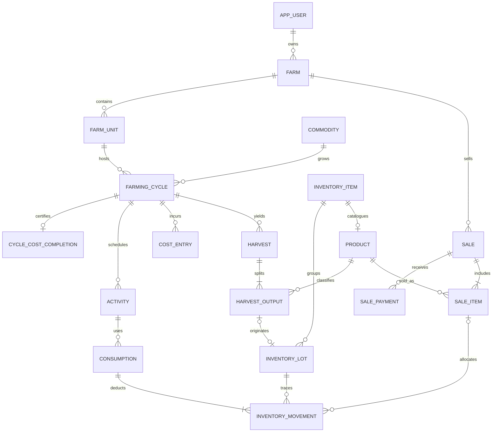

# Model domain

Diagram menunjukkan kardinalitas domain yang dituju. SQL mengikat referensi; transaksi
service menjamin jumlah child minimal (misalnya satu output/line) ketika posting.

Satu cycle memiliki banyak harvest, masing-masing banyak output/grade/product. Satu output
membuat satu lot; lot pembelian/stock opening tidak memiliki harvest_output. Produk adalah
katalog, bukan saldo. Setiap sale line dapat mengambil beberapa lot melalui movement,
sehingga penjualan dapat ditelusuri kembali ke output, harvest, cycle, unit dan commodity.
Tidak ada sale.cycle_id tunggal yang menyesatkan saat stok berasal dari banyak siklus.

FarmUnit tepat satu Pond/Coop/GrowingArea; FarmingCycle tepat satu subtype sesuai type.
Compound FK mencocokkan farm dan type; penulisan parent-child wajib satu transaksi.
Commodity farm-scoped agar nama/varietas tidak membocorkan katalog farm lain.

CostEntry dapat farm-level atau cycle-level; activity wajib sesuai cycle. inventoryMovementId
opsional menghubungkan biaya dengan sumber stok. Source key unik menghindari ulang sumber
yang sama. Cost treatment membedakan purchase, production, capital dan unclassified.
Biaya bersama dialokasikan manual ke siklus, sementara valuasi barang untuk dijual
kembali belum dimodelkan. Revenue dan HPP adalah proyeksi dari payment/refund,
biaya, harvest, sale dan movement; keduanya bukan tabel fakta terpisah.

Sumber data definitif: [migration](../db/migrations/001_foundation.sql). Penjelasan PK/FK,
nullability, audit, index dan batas enforcement ada di [database.md](database.md).
