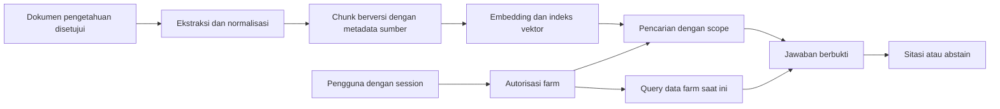

# Remaining MVP implementation roadmap

Tujuan: selesaikan alur operasional secara bertahap dengan fondasi ini. Agen mengerjakan
satu task, memperbarui status/test, lalu menyerahkan hasil. Baca AGENTS.md dan kontrak
modul terkait. Jangan mengimplementasikan seluruh tabel sekaligus.

Task 01–20 **selesai untuk cakupan MVP/Core yang disepakati**; Phase 2/3 masih berjalan. Verifikasi PostgreSQL gabungan Task 20 selesai pada 2026-10-01; detail versi dan batas pengujiannya ada di `docs/verification.md`.
Interface, schema dan helper yang sudah tersedia dipakai kembali. Model/stack tidak perlu
dirancang ulang. Perubahan produk yang belum diputuskan dicatat, tidak ditebak.

Setiap task: tulis tes penerimaan terfokus, implementasi minimal, jalankan tes terkait,
typecheck, build bila client/API berubah. Jangan klaim tes PostgreSQL sudah lewat hanya
karena PGlite lewat. Commit bila proyek sudah dikelola Git; jangan mengubah repo lain.

## 01 — Farm registry dan farm-scoped CRUD

**Status: selesai pada 2026-09-28.** Create/list/get/update/archive, pemilihan farm aktif,
farm-scoped HTTP, migration 002 dan tes PGlite tersedia. UI dan API memakai identitas
akun lokal dari Task 02.

- **Objective:** membuat farm pertama dan memilih farm aktif.
- **Files:** src/modules/farms/{contracts,service,queries}.ts, src/server/app.ts,
  src/client/farms.tsx, tests/farms.test.ts.
- **Dependencies:** app_user berasal dari trusted identity mapping; tests memakai fixture.
  Production identity adapter tersedia dari Task 02.
- **Required behavior:** createFarm(db,actorId,raw): Promise<FarmSummary> memakai createFarmInput.
  Lock app_user FOR UPDATE, farm.id=idempotencyKey untuk creation, authorize existing owner,
  cocokkan receipt hash sebelum replay, lalu insert farm+receipt satu transaction.
  listFarms hanya owner; update name/location dengan farm lock; archive flag baru melalui
  migration bila arsip diperlukan, jangan hard-delete farm berisi data.
- **Acceptance:** double create key sama mengembalikan farm sama; perubahan payload 409;
  user lain tidak bisa melihat/mengubah/claim id farm; UI memperlihatkan scope farm aktif.
- **Tests:** create twice -> row count 1; foreign owner list empty/update forbidden;
  gagal receipt insert -> farm creation rollback; blank name 422.

## 02 — Identity adapter dan boundary HTTP

**Status: selesai pada 2026-09-28.** Akun lokal email/kata sandi dipilih pemilik produk.
Migration 003, sesi terverifikasi, UI masuk/daftar/keluar, origin/CSRF, dan tes PGlite
tersedia. Deployment PostgreSQL nyata dan email verification belum dilakukan.

- **Objective:** menghubungkan session terverifikasi ke app_user.
- **Files:** src/server/{identity,app,main}.ts; tests/identity.test.ts; docs/architecture.md.
- **Dependencies:** pilih provider/session strategy bersama pemilik produk sebelum koneksi nyata.
- **Required behavior:** ResolveIdentity memvalidasi session, memetakan auth_subject, tidak
  menerima actorId dari body/header. Tetap owner-only MVP. Terapkan CSRF bila session cookie,
  secure cookie/TLS/expiry/logout, origin policy dan log redaction sesuai strategi terpilih.
- **Acceptance:** user valid dapat mengakses farm sendiri; expired/forged session 401;
  farm lain 403; tidak ada bypass development di production.
- **Tests:** valid/invalid/expired session, forged x-user-id, cross-farm, CSRF sesuai adapter.

## 03 — Farm Unit shared CRUD

**Status: selesai pada 2026-09-28.** API dan UI daftar/buat/ubah/arsip unit tersedia
untuk ikan, ayam, dan tanaman; detail tipe dan receipt ditulis atomik. Siklus dan
halaman detail unit tetap menjadi pekerjaan task berikutnya.

- **Objective:** transaksi parent+typed detail dan daftar unit.
- **Files:** src/modules/farming/{contracts,service,queries}.ts;
  tests/units.test.ts; src/client/units.tsx.
- **Dependencies:** 01, createUnitInput.
- **Required behavior:** createUnit(db,ctx,raw)->{unitId}; pilih tepat satu subtype berdasarkan
  discriminant, insert parent+detail bersama. Update name/location/dimensions; archive hanya
  sesuai aturan cycle aktif, tidak delete histori. Type tidak boleh berubah setelah cycle ada.
- **Acceptance:** ketiga subtype tersimpan dan ditampilkan dengan satuan, data farm terpisah.
- **Tests:** subtype mismatch, invalid area, rollback detail failure, duplicate name, foreign farm.

## 04 — Fish unit flow

**Status: selesai pada 2026-09-28.** Daftar dan detail kolam hanya menampilkan unit
FISH di farm milik akun aktif. Pond condition dapat dibuat/diubah, siklus terkait
dibaca melalui endpoint scoped, dan kondisi loading/error/kosong tersedia.
Pembuatan dan transisi siklus tetap milik Task 07.

- **Objective:** halaman daftar/detail kolam dengan form atribut ikan.
- **Files:** src/client/farming/fish.tsx, src/modules/farming/unit-queries.ts; tests fish-route.
- **Dependencies:** 03.
- **Required behavior:** /farm/fish dan /farm/fish/:unitId hanya FISH; dimensi/capacity/condition
  menggunakan model Pond; tampilkan daftar cycle terkait dari scoped query.
- **Acceptance:** buat/update kolam berhasil dan refresh persisten; loading/error/empty nyata.
- **Tests:** route ayam tidak bocor di fish, save failure tetap mempertahankan input, mobile form.

## 05 — Chicken unit flow

**Status: selesai 2026-09-29.** Daftar, detail, ubah, dan arsip kandang memakai
endpoint unit farm-scoped yang sama dengan registry. Detail menampilkan lokasi,
luas, dan kapasitas Coop tanpa field kolam. Pembuatan siklus tetap Task 07.
Build dan pemeriksaan visual desktop/ponsel lulus; tes otomatis dan PostgreSQL
belum dijalankan pada pengerjaan Task 05.

- **Objective:** halaman kandang yang memakai shared unit service.
- **Files:** src/client/farming/chicken.tsx; tests chicken-route.
- **Dependencies:** 03.
- **Required behavior:** /farm/chicken dan detail, capacity_heads/area sesuai Coop.
- **Acceptance:** CRUD farm-scoped tanpa atribut kolam/pH pada kandang.
- **Tests:** foreign unit 404, invalid capacity, refresh persisted data, keyboard form.

## 06 — Crop area flow

**Status: selesai 2026-09-29.** Daftar, detail, ubah, dan arsip area tanam
memakai endpoint unit farm-scoped. Detail menampilkan lokasi, media tanam,
luas, dan kapasitas GrowingArea; route menolak tipe unit lain. Pembuatan
siklus tetap Task 07. Build dan pemeriksaan visual desktop/ponsel lulus;
tes otomatis dan PostgreSQL belum dijalankan pada pengerjaan Task 06.

- **Objective:** halaman area/media tanam.
- **Files:** src/client/farming/crops.tsx; tests crop-route.
- **Dependencies:** 03.
- **Required behavior:** growing area media, area_m2, capacity_plants; /farm/crops/detail.
- **Acceptance:** field media/luas jelas, unit/type tidak tertukar.
- **Tests:** type mismatch, zero/negative area, saved display and error recovery.

## 07 — Cycle CRUD dan observation dasar

**Status: selesai untuk cakupan Task 07 pada 2026-09-29.** Pendaftaran
komoditas, buat/daftar/detail siklus untuk FISH/CHICKEN/CROP, transisi status
dengan expectedStatus, dan observasi eksplisit tersedia di UI/API. Data awal
dan observasi tetap dibaca setelah siklus selesai. Migrasi observasi memakai
`004_cycle_observations.sql` karena nomor 002 dan 003 sudah dipakai. Tidak ada
edit/hapus siklus atau jadwal otomatis; pekerjaan aktivitas tetap Task 08.
Tes otomatis dan PostgreSQL belum dijalankan pada pengerjaan Task 07.

- **Objective:** siklus kelas pertama untuk ketiga jenis dan pencatatan dasar monitoring.
- **Files:** src/modules/farming/{cycle-service,cycle-queries,contracts,states}.ts;
  db/migrations/004_cycle_observations.sql; src/client/farming/cycle.tsx.
- **Dependencies:** 03; pilih commodity sesuai type.
- **Required behavior:** createCycle -> parent+detail dalam transaksi, PLANNED; activate/complete
  memakai helper transition + expectedStatus + prasyarat di business-rules. Tambahkan observation
  eksplisit untuk population loss (integer), average weight g, dan condition notes dengan
  cycle/farm/actor/observed_at. Hindari menghitung metrik dari notes bebas.
- **Acceptance:** fish/chicken/crop mempertahankan field masing-masing; datum tidak hilang
  saat cycle selesai; no implicit agricultural schedules.
- **Tests:** commodity/unit type mismatch, cross-farm, invalid dates, terminal reopen, observation units.

## 08 — Activity / Schedule

**Status: selesai untuk cakupan Task 08 pada 2026-09-29.** Buat aktivitas
untuk siklus aktif, daftar dalam rentang `[from,to)`, detail, dan transisi
status eksplisit tersedia di UI/API. Receipt idempoten, `expectedStatus`,
serta audit waktu selesai/batal tersimpan atomik. Pemeriksaan browser PGlite
mencakup alur terjadwal → terlewat → berjalan → selesai dan persistensi setelah
refresh; build lulus. Tes otomatis dan PostgreSQL nyata belum dijalankan.
Recurrence dan kalender visual belum termasuk cakupan ini.

- **Objective:** jadwal satu-occurrence yang terkait cycle.
- **Files:** src/modules/schedules/{contracts,service,queries}.ts; src/client/schedule.tsx;
  tests/schedules.test.ts.
- **Dependencies:** 07.
- **Required behavior:** createActivity dan transitionActivity sesuai contracts; timestamp offset,
  expectedStatus, completed/cancelled audit; query rentang [from,to). Recurrence belum diperlukan.
- **Acceptance:** activity farm/cycle valid; jadwal dan status sama setelah refresh.
- **Tests:** timezone boundary, late completion via MISSED->IN_PROGRESS, terminal mutation,
  duplicate command, inactive cycle, simultaneous transition conflict.

## 09 — Inventory item dan lot CRUD

**Status: selesai untuk cakupan Task 09 pada 2026-09-29.** Katalog item
farm-scoped mendukung buat, daftar berpaginasi, detail, ubah, dan nonaktifkan
dengan pemeriksaan saldo/produk. Lot mendukung buat, daftar, detail, serta ubah
identitas/lokasi/kedaluwarsa. Saldo item dan lot dibaca dari agregasi ledger,
sehingga item/lot baru bernilai 0; perubahan satuan dasar ditolak setelah
pergerakan. Build dan alur browser PGlite buat item/lot serta refresh lulus.
Tes otomatis dan PostgreSQL nyata belum dijalankan pada pengerjaan Task 09.

- **Objective:** resource catalog, lokasi/expiry lot dan saldo dari ledger.
- **Files:** src/modules/inventory/{contracts,item-service,queries}.ts; src/client/inventory.tsx;
  tests/inventory-items.test.ts.
- **Dependencies:** 01.
- **Required behavior:** createItem sesuai contract, lot create; base unit immutable setelah
  movement; saldo SUM GROUP BY item/lot, minimum_stock; tidak ada edit quantity langsung.
- **Acceptance:** item baru saldo nol yang faktual; list tidak N+1; feed/livestock unit jelas.
- **Tests:** no movement -> 0, item unit change rejected, foreign lot, pagination stable.

## 10 — Inventory movement engine lengkap

**Status: selesai untuk cakupan fungsional pada 2026-09-29.** Command stock-in,
adjustment, transfer dua sisi, rusak/kedaluwarsa, dan reversal memakai farm lock
serta receipt; query riwayat farm-scoped tersedia. UI detail item mencatat
pergerakan dan menampilkan saldo lot serta jejak reversal. Pembuktian manual
PGlite mencakup stok masuk, transfer, reversal transfer, koreksi negatif,
kerusakan, serta penolakan stok tidak cukup. Suite dan tes multi-koneksi PostgreSQL
untuk stok diverifikasi pada Task 20 (2026-10-01).

- **Objective:** stock-in, adjustment, transfer, expired/damaged dan reversal terotorisasi.
- **Files:** src/modules/inventory/{ledger,contracts,movement-service}.ts; tests/ledger.test.ts.
- **Dependencies:** 09; existing deduct internal helper.
- **Required behavior:** semua command memakai farm lock+receipt; paired transfer conserved,
  exact-once opposite reversal same lot/unit, reason wajib; validate quantity sign/discrete unit.
  Tolak reversal-of-reversal; jangan mengubah original row.
- **Acceptance:** saldo benar setelah intake/correction/transfer, history dapat ditelusuri.
- **Tests:** transfer sum=0, reverse twice rejected, cross-farm denied, negative stock rollback,
  multi-connection concurrent writers lewat test:postgres.

## 11 — Consumption UI dan workflow

**Status: selesai untuk cakupan fungsional pada 2026-09-29.** Detail aktivitas
menampilkan form item/lot/kuantitas dan riwayat pemakaian. Opsi stok dan
histori dibaca farm-scoped; command consume tetap memakai farm lock, receipt,
dan ledger yang sudah tersedia. Tombol selesai aktivitas tetap command terpisah.
Pratinjau PGlite menunjukkan 3 kg pemakaian mengubah saldo 22→19 kg dan
penolakan 999 kg mempertahankan nilai form. Tes otomatis dan replay setelah
respons hilang masuk suite Task 20; PostgreSQL nyata juga diverifikasi pada
2026-10-01.

- **Objective:** menghubungkan activity ke service consume yang sudah ada.
- **Files:** src/client/inventory/consume-form.tsx; src/modules/inventory/{service,queries}.ts;
  tests/consumption-ui.test.ts.
- **Dependencies:** 08,10,02 untuk UI authenticated.
- **Required behavior:** pilih item/lot, quantity/unit; simpan stable idempotencyKey selama retry;
  refresh saldo setelah commit; tampilkan histori activity. Selesai activity merupakan command terpisah.
- **Acceptance:** double-click/retry tidak double consume; error tidak mengosongkan input.
- **Tests:** network response lost lalu retry, insufficient stock, stale lot choice, cycle closed.

## 12 — Raw cost recording

**Status: selesai untuk cakupan fungsional pada 2026-09-29.** Pencatatan biaya
selalu menghasilkan UNCLASSIFIED dengan sourceKey unik. Relasi siklus,
aktivitas, dan movement divalidasi dalam transaksi farm-scoped. Koreksi
membatalkan versi asal, mencatat alasan, dan membuat baris pengganti dengan
`correction_of`; pembatalan mandiri juga beralasan. Migrasi 005 menjaga
keunikan satu biaya POSTED per movement. UI membedakan pembelian persediaan,
biaya aktivitas/siklus, dan biaya farm, tanpa menampilkan HPP. Pratinjau
PGlite menunjukkan pembelian Rp 4.250.000 dikoreksi menjadi Rp 4.200.000,
serta biaya aktivitas Rp 150.000 menjadi Rp 140.000 dengan alasan audit.
Tes otomatis dan PostgreSQL nyata belum dijalankan.

- **Objective:** catat biaya tanpa menggandakan production cost.
- **Files:** src/modules/finance/{contracts,cost-service,queries}.ts; src/client/finance/costs.tsx;
  tests/costs.test.ts.
- **Dependencies:** 07,10.
- **Required behavior:** recordCost menghasilkan UNCLASSIFIED, sourceKey unik; reference movement
  harus cocok konteks cycle/activity. Koreksi audited; perubahan treatment PRODUCTION tidak
  diaktifkan sampai policy task 16 tersedia.
- **Acceptance:** raw amount tidak disebut HPP; pembelian inventory dibedakan dari beban produksi.
- **Tests:** source duplicate, cross-cycle activity, money overflow, missing source, rollback.

## 13 — Product catalog

**Status: selesai untuk cakupan fungsional pada 2026-09-29.** Produk aktif/nonaktif, nama,
grade dan harga acuan dikelola farm-scoped. Setiap produk memakai item hasil panen
tersendiri; dua grade Lele telah dibuat dan status produk diuji di pratinjau PGlite.
Build berhasil; tes otomatis dan PostgreSQL nyata diverifikasi pada Task 20.

- **Objective:** definisi jual terpisah dari stok.
- **Files:** src/modules/products/{contracts,service,queries}.ts; src/client/products.tsx;
  tests/products.test.ts.
- **Dependencies:** 09, commodity dari 07.
- **Required behavior:** createProduct memakai item HARVEST_PRODUCT, satuan dari item, grade/name,
  target price optional; nonaktif tanpa menghapus sales history.
- **Acceptance:** dua grade boleh berbeda produk/item; harga bukan saldo.
- **Tests:** invalid item category, cross-farm commodity, duplicate item linkage, inactive product.

## 14 — Harvest posting dan product inventory

**Status: selesai untuk cakupan fungsional pada 2026-09-29.** Posting panen membuat
harvest, output, lot, movement STOCK_IN dan receipt dalam satu transaksi. UI
menangani beberapa grade/output dan menampilkan saldo/asal siklus. Pembatalan
membuat reversal atomik dan ditolak jika stok telah dipakai. Panen Lele dua grade
12,5 kg dan 6,25 kg diverifikasi di pratinjau PGlite; pembatalan setelah stok
terjual ditolak. Tes otomatis dan PostgreSQL nyata diverifikasi pada Task 20.

- **Objective:** dari cycle menjadi saleable lots secara atomik.
- **Files:** src/modules/harvest/{contracts,service,queries}.ts; src/client/harvest.tsx;
  tests/harvest.test.ts.
- **Dependencies:** 07,10,13. Product sudah dipilih/ada sebelum posting.
- **Required behavior:** postHarvest -> HarvestReceipt; validate product commodity matches cycle,
  ACTIVE cycle/date; insert harvest+N outputs+N lots+N STOCK_IN+receipt. Gunakan helpers tx,
  bukan nested command. Tidak menyelesaikan cycle otomatis. Hasil per output boleh kg/head/unit.
- **Acceptance:** partial/multiple harvest/grade/output dan provenance sampai lot tersimpan.
- **Tests:** retry same key, failure output kedua rollback, grade mismatch, kg vs head,
  cancel harvest setelah stock terjual tidak boleh negatif.

## 15 — Sales UI, detail dan correction

**Status: selesai untuk cakupan fungsional pada 2026-09-29.** Form multi-item
memakai `completeSale`, harga/total dihitung server, alokasi lot terhubung ke
panen/siklus pada detail, dan pembatalan mencatat reversal stok beralasan.
Penjualan dua grade 3 kg + 2 kg bernilai Rp 142.000, lalu pembatalan dan
pemulihan stok, diverifikasi di pratinjau PGlite. Satu baris form memilih satu
lot; produk yang sama dapat ditambah sebagai baris lain untuk alokasi beberapa
lot. Tes konkurensi, replay, dan PostgreSQL nyata diverifikasi pada Task 20.

- **Objective:** memakai completeSale reference dengan alokasi lot dan audit jelas.
- **Files:** src/modules/sales/{service,queries,contracts}.ts; src/client/sales.tsx;
  tests/sales-ui.test.ts, tests/postgres/concurrency.test.ts.
- **Dependencies:** 02,10,13,14.
- **Required behavior:** multi-item form; totals server; detail line->movement->lot->harvest->cycle.
  Draft editing optional; jangan memberi kesan fitur payment sudah ada. Cancellation menggunakan
  reversal satu transaction. Terapkan kebijakan expired stock yang disetujui sebelum production.
- **Acceptance:** retry tidak double sale, oversell ditolak, mixed-cycle origins terlihat.
- **Tests:** concurrent oversell, retry after lost response, cross-farm product, correction twice,
  partial failure rollback. Existing tests diperluas, tidak disalin tanpa kebutuhan.

## 16 — Finance policy, payments dan HPP

**Status: selesai untuk cakupan MVP pada 2026-09-30.** Pemilik produk menyetujui
`finance-mvp-v1`, yang menetapkan pengakuan revenue, klasifikasi biaya, HPP
berdasarkan berat, kelengkapan biaya, pembayaran parsial, refund, dan reversal
COGS saat pembatalan sale. Migrasi 007 dan endpoint farm-scoped menambahkan
proyeksi HPP per siklus serta penanda biaya lengkap. Dashboard/analitik memakai
proyeksi payment, refund, HPP, dan profit dengan source IDs serta alasan
`UNAVAILABLE` bila data belum lengkap. Aturan rinci ada di
`docs/decisions/finance-policy.md`.

- **Objective:** metrik reproducible sesuai keputusan produk yang terdokumentasi.
- **Files:** docs/decisions/finance-policy.md; src/modules/finance; migration 006–007;
  src/modules/analytics; tests/business-flow.test.ts.
- **Dependencies:** 12,14,15; seluruh aturan finance MVP disetujui pemilik produk.
- **Required behavior:** policy/versioned projections dengan exact arithmetic,
  `asOf`, method, source IDs dan alasan `UNAVAILABLE`; payment ledger menentukan revenue.
- **Acceptance:** result dapat direproduksi dari source ids+policy, tidak double count purchase/use,
  penjualan parsial tidak dibebani seluruh cycle cost tanpa metode yang tepat.
- **Tests:** true zero vs biaya belum lengkap, biaya konsumsi terukur, berat hilang,
  alokasi parsial, payment/refund, batas tanggal, dan reversal COGS saat pembatalan.

## 17 — Dashboard read model

**Status: selesai untuk cakupan fungsional pada 2026-09-30.** Query farm-scoped
menghitung unit/siklus aktif, aktivitas hari ini dan mendatang, produksi panen,
biaya mentah bulan ini, nilai transaksi selesai, revenue, COGS/HPP, dan profit.
Metrik finance menjadi `UNAVAILABLE` dengan alasan jika sumber belum lengkap.

- **Objective:** ringkasan farm yang benar-benar berasal dari SQL records.
- **Files:** src/modules/analytics/{contracts,dashboard-queries}.ts; src/client/dashboard.tsx;
  tests/dashboard.test.ts.
- **Dependencies:** 07,08,11,14,15; finance 16 bila metrik finansial ditampilkan.
- **Required behavior:** getDashboard(db,identity,scope)->DashboardSummary; grouped SQL,
  asOf, active cycles/upcoming activity/production/commercial totals dan finance projection.
- **Acceptance:** berubah sesudah transaksi; farm kosong terlihat kosong/0 yang benar; no fake KPI.
- **Tests:** cancelled records excluded, cross-farm exclusion, grouped units, query count bounded.

## 18 — Basic analytics

**Status: selesai untuk cakupan operasional dan finance pada 2026-09-30.** Produksi
POSTED dikelompokkan per siklus/komoditas/satuan pada rentang `[from,toExclusive)`.
Filter siklus farm-scoped dan tanggal eksplisit tersedia. Pratinjau demo
menunjukkan Lele 18,75 kg dari satu kejadian panen. Revenue/HPP/profit memakai
kebijakan finance terversi; survival, growth dan efisiensi pakan menampilkan
alasan `UNAVAILABLE` sampai input/aturan cukup.

- **Objective:** production per cycle/commodity/period serta metric dasar yang terdefinisi.
- **Files:** src/modules/analytics/{queries,contracts}.ts; src/client/analytics.tsx;
  tests/analytics.test.ts; docs/decisions/metric-definitions.md.
- **Dependencies:** 07 observation,14,16.
- **Required behavior:** [from,toExclusive), unit dan baseline eksplisit; finance calls projection;
  survival/growth/feed efficiency hanya bila definisi dan data cukup. No analytics database.
- **Acceptance:** setiap angka ditelusuri ke source dan formula; unsupported metric unavailable.
- **Tests:** time boundary, missing baseline, mortalities vs partial harvest, denominator zero,
  farm mixing, kg/head summation rejected.

## 19 — UX/error states dan hardening

**Status: selesai pada 2026-09-30.** Error alasan pembatalan terhubung ke
kolom dan dibacakan dengan ARIA, modal punya nama unik dan terkunci saat submit,
respons API membawa request ID tanpa membocorkan detail SQL, dan template grant
database least-privilege tersedia. Snapshot aksesibilitas pada 14 rute menu dan
11 halaman detail demo tidak menemukan tombol/tautan tanpa nama; fokus Tab pertama
di dashboard dan halaman ikan mencapai tautan lewati ke konten utama. Browser
ponsel 390 px tidak mengalami overflow dokumen pada dashboard, penjualan, panen,
dan analitik. Enam tes transport/status/session memastikan pesan aman saat fetch farm/akun
gagal dan status 401/503 sesi tetap dapat dibedakan. AuthGate hanya membuka login
untuk 401; gangguan lain menampilkan pesan sesi aman dengan tombol coba lagi.
Label serta urutan Tab Email → kata sandi → Masuk → Daftar pada layar autentikasi
juga diperiksa. Pada sesi farm kosong, traversal Tab untuk 14 halaman menu dan
form pembuatan farm mencapai seluruh kontrol bernama tanpa fokus tersangkut.
Audit UI dengan farm sintetis memeriksa daftar/detail unit ikan, ayam, dan tanaman,
daftar/detail siklus, observasi, jadwal, persediaan, panen, produk, penjualan, biaya,
HPP, dan analitik; prasyarat serta unavailable states tampak jelas. Simulasi browser
mematikan API membuktikan `/me` menampilkan sesi unavailable, lalu tombol coba lagi
memulihkan pemeriksaan setelah API hidup. Submit buat kolam saat API mati menunjukkan
error aman dengan nilai tetap; kirim ulang setelah API hidup menyimpan satu kolam.
Uji klik ganda tombol Buat kolam menghasilkan satu kolam. Audit AST pada 37 call-site
mutasi POST/PATCH memastikan semuanya memakai kunci idempotensi dan `try/catch`;
blok `catch` tidak mengubah draft pengguna atau kunci retry. Perilaku transport
bersama diuji otomatis, sedangkan simulasi outage browser dilakukan pada form kolam.
Grant diuji pada PostgreSQL 18.6; role runtime bisa menjalankan auth/farm,
tidak bisa CREATE, dan batas ledger diverifikasi.

- **Objective:** alur konsisten pada mobile/desktop dan kegagalan jaringan.
- **Files:** src/client/components/primitives.tsx, client route modules, src/server/app.ts;
  tests untuk regression yang ditemukan; docs/verification.md.
- **Dependencies:** 01–18 untuk fitur yang relevan.
- **Required behavior:** accessible field errors, loading/empty/error/success, guarded submit,
  stable retry keys, native confirmation, focus/keyboard/mobile; sanitized logs/request IDs,
  runtime DB grants dan deployment session protections. Jangan menambah visual polish berlebihan.
- **Acceptance:** aksi gagal tidak tampak sukses, data input tidak hilang, unavailable jelas.
- **Tests:** form keyboard/labels, mobile overflow, API failure, duplicate clicks, invalid body,
  unauthorized queries, secret-free error response, no future-phase menu promises.

## 20 — End-to-end MVP verification

**Status: selesai pada 2026-10-01.** Alur ikan menelusuri farm sampai penjualan,
termasuk aktivitas, stok pakan, konsumsi, biaya, panen parsial multi-grade,
dashboard, analytics, pembayaran, dan reversal. Alur ayam dan tanaman juga
menelusuri unit, siklus, aktivitas, stok masuk, konsumsi, biaya pembelian dan
produksi, dua panen parsial dengan berat terukur, penjualan, pembayaran, HPP,
dashboard revenue, dan analitik tanpa mencampur satuan. Isolasi tenant, kalkulator
HPP, error API aman, migrasi dari schema sebelumnya, AuthGate, dan restart PGlite
berbasis folder turut tercakup. Suite penuh serial lulus 82/82 memakai seluruh
migrasi PGlite 001–013, termasuk riwayat limbah, membership, circular posting/transfer,
inbox notifikasi, dan volume air di analitik. `npm run build` dan `npm run format:check`
juga lulus pada 2026-10-01. PostgreSQL 18.4 menerapkan migrasi 001-013 pada database
uji terpisah, grant runtime dan batas akses diperiksa, serta `npm run test:postgres`
lulus 1/1 dengan dua koneksi. Task 20 memenuhi penerimaan; riwayat lingkungan uji ada
di `docs/verification.md`.

- **Objective:** membuktikan alur operasional lengkap untuk ketiga cabang.
- **Files:** `tests/business-flow.test.ts`, `tests/postgres/`,
  `docs/verification.md`, README.md.
- **Dependencies:** 01–19; authenticated PostgreSQL test environment.
- **Required behavior:** buat farm/unit/cycle/activity, intake resource, consume, raw costs,
  partial harvest+multi-grade, sale, agreed HPP, dashboard/analytics; semua fixture diberi label.
- **Acceptance:** ikan/ayam/tanaman masing-masing selesai, bukan hanya happy path fish;
  persistence setelah restart, migration fresh DB dan existing DB aman, no cross-farm leakage.
- **Tests:** full business journey, concurrent consumption/sale, failed persistence rollback,
  replay after timeout, cancellation/reversal, build/typecheck/format dan browser flows.

Phase 2/3 tidak termasuk task ini. Integrasinya mengikuti extension points di architecture.md.

## Phase 3 — AI Assistant dengan RAG

**Status: fondasi Knowledge Center lokal telah diimplementasikan pada branch
`codex/p3-03-knowledge-center`; typecheck dan build lulus.** Registry dan UI sumber
terkurasi menyimpan file secara lokal, mewajibkan tinjauan hak pakai, dan menerapkan
status/retensi. Migration diterapkan di PGlite preview lokal; runtime grants/PostgreSQL
belum diverifikasi dan UI belum diperiksa di browser. Belum ada
ekstraksi, chunking, vector index, retrieval, endpoint jawaban, atau chat assistant.
Keputusan sumber lokal disetujui; SOP aktual, validasi environment produksi, provider,
vector store, dan batas biaya masih menjadi gate.

### Referensi `finetune-prep`

Arsip `finetune-prep-a.zip` yang diberikan pemilik proyek berisi aplikasi RAG lengkap,
bukan pipeline fine-tuning model. SHA-256 arsip yang diperiksa:
`21B5D900870EAE8A4E183933AF3947DC08CCE921B5173D8F0B08711C38C66175`.
Referensi daringnya
[rraahh133/finetune-prep](https://github.com/rraahh133/finetune-prep); README aplikasi
ada di [`asisten-pintar/README.md`](https://github.com/rraahh133/finetune-prep/blob/main/asisten-pintar/README.md).
[`rag_ingest.py`](https://github.com/rraahh133/finetune-prep/blob/main/rag_ingest.py)
mengekstrak PDF, TXT, Markdown, notebook, DOCX, XLSX, dan gambar (OCR opsional),
membersihkan teks, memotong di batas paragraf, membuat embedding SentenceTransformers,
lalu menyimpan vektor cosine ke ChromaDB.
[`backend.py`](https://github.com/rraahh133/finetune-prep/blob/main/asisten-pintar/backend.py)
menambahkan upload/pemindaian folder, API pengelolaan dokumen, dan chat streaming;
[`rag_chat.py`](https://github.com/rraahh133/finetune-prep/blob/main/rag_chat.py)
menunjukkan top-k retrieval, sitasi file/chunk, dan abstain jika bukti kurang.

Yang diadaptasi adalah urutan ekstraksi → normalisasi → chunking → embedding/index →
retrieval → jawaban bersitasi/abstain. Batas contoh yang wajib diperbaiki untuk OpSmart:
metadata utamanya hanya nama file dan nomor chunk, collection Chroma bersifat bersama,
alur retrieval yang diperiksa tidak memfilter farm, prompt default membahas keamanan
siber, dan arsip tidak menyertakan file lisensi atau commit ID. Karena itu jangan
menyalin kode/dependensi atau memakai dokumen contoh; gunakan repo sebagai referensi
konsep. RAG-01 mencatat hash arsip/provenance dan memastikan status lisensi dari
pemilik sebelum mempertimbangkan penggunaan kode.

### Batas arsitektur MVP

- RAG mencari pengetahuan statis yang dikurasi, seperti SOP, panduan budidaya,
  dokumen komoditas, dan manual perangkat yang disetujui.
- Fakta farm yang berubah, seperti stok, aktivitas, panen, pembayaran, atau HPP,
  dibaca saat menjawab melalui query/read contract farm-scoped yang ada. Jangan
  mengandalkan embedding lama sebagai sumber angka operasional.
- Autentikasi memakai identitas session server dan farm aktif yang telah diotorisasi.
  Batasi scope sebelum pencarian; jangan mengambil lintas farm lalu menyaring hasil
  setelahnya. Farm scope mengikuti membership; tidak ada matriks role.
- Jawaban hanya baca: tidak ada tool untuk membuat jadwal, mengubah stok, mencatat
  biaya, atau melakukan command lain. Rekomendasi, prediksi, dan tindakan otomatis
  tetap di luar MVP sampai kebijakan serta evaluasinya disetujui.
- Teks dokumen adalah data tidak tepercaya, bukan instruksi untuk model atau tool.
  Setiap klaim berbasis dokumen harus membawa sitasi yang dapat dibuka; jika bukti
  tidak memadai, assistant menyatakan belum dapat menjawab.
- Tahap awal menggunakan dokumen pengetahuan terkurasi. Unggah dokumen pribadi per
  farm ditunda sampai aturan akses, retensi, penghapusan, dan pemilik dokumennya jelas.

### Urutan implementasi

#### RAG-01 — Audit referensi dan keputusan sumber

**Status: keputusan sumber lokal parsial disetujui pada 2026-10-03.** Batas shared/farm,
status pending, persetujuan hak pakai, storage lokal, format PDF/Markdown/TXT, serta
purge konten 24 jam dan audit 90 hari dicatat di
`docs/decisions/rag-architecture.md`. Pemilik memilih SOP internal dengan hak pakai
jelas, tetapi file, bukti hak, audience, kecocokan komoditas/sistem, versi, dan masa
review/expiry belum diberikan; belum ada sumber yang disetujui. Lingkungan produksi,
provider/vector store, dan biaya tetap terbuka. Kandidat
eksternal Kementan, KKP, dan WorldFish yang diaudit tetap hanya bahan riset, bukan jalur
sumber terpilih; tidak ada konten yang diunduh atau diindeks.

- **Files:** `docs/decisions/rag-architecture.md`, `docs/architecture.md`,
  `docs/implementation-roadmap.md`.
- **Dependencies:** Verifikasi PostgreSQL Task 20 selesai; sesi dan farm farm-scoped.
- **Required behavior:** catat hash arsip/commit dan lisensi referensi; tetapkan allowlist jenis
  dokumen, pemilik/sumber, audience global atau farm, klasifikasi data, persetujuan,
  masa berlaku, retensi, dan penghapusan. Bandingkan provider embedding dan vector
  store terhadap deployment OpSmart, termasuk dukungan PostgreSQL/extension, backup,
  biaya, latency, dan isolasi tenant. Jangan memilih Chroma hanya karena contoh
  referensi memakainya.
- **Acceptance:** keputusan menyebut sumber yang boleh diindeks, data yang dilarang,
  batas tenant, provider/vector store yang dipilih beserta alasan dan fallback, serta
  alur reindex dan delete. Penggunaan kode referensi tidak dilakukan sebelum lisensinya
  dipastikan. Tidak ada fine-tuning model pada tahap ini.
- **Verification:** tinjau threat model untuk dokumen berisi prompt injection,
  dokumen kedaluwarsa, pencabutan akses, dan data lintas farm.

#### RAG-02 — Registry sumber dan pipeline ingestion deterministik

**Status: fondasi registry Knowledge Center tersedia pada branch
`codex/p3-03-knowledge-center`; ekstraksi/chunk/index belum tersedia.** Upload tetap
`PENDING_REVIEW`; persetujuan belum mengaktifkan RAG.

- **Files:** `db/migrations/016_knowledge_sources.sql`,
  `src/modules/knowledge/{contracts,service,queries,retention}.ts`,
  `src/client/knowledge.tsx`.
- **Dependencies:** RAG-01.
- **Required behavior:** ingestion hanya membaca registry/allowlist, memvalidasi format
  dan ukuran, mengekstrak format yang disepakati, menormalkan whitespace sambil
  mempertahankan heading/halaman, lalu membentuk chunk di batas paragraf/section.
  Rekomendasi MVP: mulai dari PDF, Markdown, dan TXT; notebook, DOCX, XLSX, gambar,
  serta OCR ditunda sampai ada kebutuhan sumber yang jelas dan evaluasi parser.
  ID chunk stabil berasal dari document ID, revision, urutan lokal, dan hash konten;
  jangan memakai nomor global yang berubah setiap full ingest. Simpan document/source
  ID, revision, content hash, section/page, bahasa, tenant scope, extractor/chunker
  version, dan waktu ingestion. Duplicate input tidak membuat versi ganda; reindex
  mengganti versi lama dan penghapusan membersihkan chunk/index terkait.
- **Acceptance:** ingestion dapat diulang deterministik, dokumen kosong/rusak/unsupported
  ditolak dengan status aman, sitasi dapat menunjuk ke sumber/section, dan perubahan
  versi atau pencabutan sumber tidak meninggalkan chunk lama yang dapat dicari.
- **Tests:** paragraf lebih panjang dari limit, heading/page boundary, dokumen duplikat,
  encoding invalid, content hash berubah, empty extraction, delete/reindex, tenant scope.

#### RAG-03 — Adapter embedding dan vector index

- **Files:** `src/modules/knowledge/{embedding,vector-store}.ts`,
  `src/server/knowledge-index.ts`, `tests/knowledge-index.test.ts`,
  konfigurasi provider yang dipilih pada RAG-01.
- **Dependencies:** RAG-01, RAG-02.
- **Required behavior:** gunakan interface embedding dan vector store terpisah dari
  route/UI. Catat model dan versi dimensi embedding pada tiap index generation; cegah
  pencampuran vector dari model berbeda; dukung upsert, delete, rebuild, dan status
  generation. Metadata sumber/tenant menjadi filter pencarian wajib. Metadata dokumen
  utama tetap berada pada storage transaksional; vector index dapat dibangun ulang.
- **Acceptance:** full rebuild menghasilkan index generation konsisten dan tidak
  mengubah sumber kebenaran dokumen. Provider, key, dan URL hanya dibaca server-side.
- **Tests:** provider unavailable, dimensi model berubah, retry batch, delete/rebuild,
  filter tenant diterapkan sebelum top-k.

#### RAG-04 — Retrieval dan konteks data farm

- **Files:** `src/modules/knowledge/{retrieval,contracts}.ts`,
  `src/server/app.ts`, `tests/knowledge-retrieval.test.ts`.
- **Dependencies:** RAG-02, RAG-03, kontrak session/farm yang ada.
- **Required behavior:** resolve actor dari session server; validasi farm aktif;
  retrieval menerima scope terotorisasi dan menerapkan filter sebelum pencarian.
  Ambil data real-time hanya melalui query/read contract modul yang relevan. Batasi
  top-k dan ukuran konteks, hindari duplikasi chunk, dan bawa source ID, revision,
  section/page, serta skor untuk sitasi dan ambang abstain.
- **Acceptance:** tidak ada data farm lain dalam hasil atau konteks LLM; hasil sumber
  dapat diaudit; query tanpa bukti cukup mengembalikan status `INSUFFICIENT_EVIDENCE`.
- **Tests:** owner/farm asing, filter scope, no-match, sumber kedaluwarsa/dicabut,
  prompt injection dalam dokumen, hasil terlalu panjang, dan data live vs dokumen lama.

#### RAG-05 — Jawaban bersitasi dan UI assistant read-only

- **Files:** `src/server/app.ts`, `src/modules/knowledge/answer-service.ts`,
  `src/client/{assistant.tsx,assistant-api.ts}`, `src/client/routes.ts`,
  `tests/assistant.test.ts`.
- **Dependencies:** RAG-04; layout mengikuti dashboard OpSmart yang sudah ada.
- **Required behavior:** kirim query, konteks terpilih, dan aturan jawaban ke LLM dari
  server; jangan kirim secret provider ke browser. Instruksikan model memakai bukti
  yang diberikan, mengabaikan instruksi di dalam dokumen, menautkan setiap klaim
  dokumenter ke sitasi, serta menyebut waktu baca untuk fakta farm yang dinamis.
  UI menampilkan sumber dan section, jawaban tidak cukup, kosong, loading, error, dan
  retry. Endpoint tidak mengekspos command/mutation tools.
- **Acceptance:** jawaban faktual dapat ditelusuri; provider failure tidak kehilangan
  pertanyaan; tidak ada jawaban yang tampak sebagai data real bila sumber gagal.
- **Tests:** sitasi, abstain, provider timeout, retry tanpa duplikasi, no mutation route,
  sitasi menuju sumber yang diizinkan, keyboard/mobile/error states.

#### RAG-06 — Evaluasi kualitas dan release gate

- **Files:** `tests/knowledge-evals/`, `tests/postgres/knowledge-isolation.test.ts`,
  `docs/verification.md`, `docs/decisions/rag-architecture.md`.
- **Dependencies:** RAG-01 sampai RAG-05; PostgreSQL integration test environment.
- **Required behavior:** siapkan pertanyaan Bahasa Indonesia yang mewakili variasi
  istilah budidaya, expected source/section, jawaban yang perlu abstain, serta pertanyaan
  data farm. Ukur retrieval Recall@k/MRR, kecocokan sitasi/grounding, abstain, latency,
  dan biaya. Jalankan uji kebocoran lintas farm, prompt injection, dokumen usang/hapus,
  provider outage, dan perubahan model/index.
- **Acceptance:** threshold rilis ditetapkan dari baseline dataset dan ditinjau manusia;
  setiap run merekam versi corpus, extractor/chunker, embedding, prompt, dan model.
  Tidak ada klaim akurasi atau rekomendasi yang belum diukur.
- **Tests:** evaluasi holdout, PostgreSQL isolation, reindex setelah update/delete,
  fallback aman saat vector/model/provider tidak tersedia.

**Contributor quality gate:** implementasi skill anti-slop mengatur mutu proses coding
UI/copy/aksesibilitas/responsif dan komentar agen. Skill tersebut bukan system prompt,
retrieval policy, atau bagian dari runtime assistant OpSmart.

## Phase 2 — Circular farming dan kolaborasi

**Status: selesai untuk lingkup implementasi lokal yang disetujui.** Semua anggota farm mendapat akses operasional dan
keuangan yang setara tanpa matriks role. Migration 008 membuat membership dan
memindahkan pemilik farm yang sudah ada menjadi anggota; query serta command memakai
membership sebagai batas akses. UI/API memungkinkan Owner menambahkan akun lokal yang
sudah terdaftar dan mengeluarkan anggota. Waste dapat
dicatat terpisah dari stok/biaya dan dipilih sebagai input batch maggot; batch mencatat
observasi, hasil dan pemakaian. P2-04 menyediakan posting eksplisit hasil batch selesai ke
lot item FEED dengan satuan sama; posting mencatat movement dan provenance dalam satu
transaksi. Transfer air kolam → area tanam mencatat liter, tanggal dan actor tanpa
perubahan stok/biaya; volume transfer tercatat tersedia di Analitik. Inbox notifikasi
in-app memakai outbox dan worker lokal; migrasi 012-013 serta grant runtime diverifikasi
pada PostgreSQL 18.4 lewat Task 20. Dua jalur sirkular yang disebut sumber produk—limbah
→ maggot → pakan dan air kolam → tanaman—sudah diimplementasikan. Jalur tambahan dan
konversi satuan belum ditentukan; jangan mengklaim penghematan otomatis karena catatan
limbah atau transfer dibuat.

### Urutan implementasi Phase 2

#### P2-01 — Keanggotaan farm dengan akses seragam

**Status: selesai secara fungsional.** Owner dapat menambah akun OpSmart terdaftar dan
mengeluarkan anggota non-owner; anggota yang masih aktif memiliki akses setara dan akun
bukan anggota tertolak. UI hanya menerima email akun OpSmart yang sudah terdaftar;
pengiriman email dan undangan bertoken tidak dipakai.

- **Files:** `db/migrations/008_farm_membership.sql`, `src/modules/farms/`, akses bersama di
  `src/server/`, endpoint di `src/server/app.ts`, UI `/farm/members`, serta tes isolasi farm.
- **Dependencies:** aturan akses dan onboarding akun lokal sudah diberikan.
- **Required behavior:** semua anggota aktif memiliki akses yang sama ke operasi dan
  keuangan farm. `farm.owner_id` tetap menjadi pemilik teknis; membership menjadi
  sumber batas akses. Hanya Owner yang menambah atau mengeluarkan anggota. Jangan mengubah actor dari sesi
  terverifikasi atau menerapkan role matrix. Seluruh anggota tetap terisolasi dari farm lain.
- **Decision:** hanya Owner yang dapat mengeluarkan anggota; Owner tidak dapat mengeluarkan
  dirinya sendiri. Disetujui 2026-09-30.
- **Acceptance:** semua anggota yang masih aktif dapat bekerja di farm yang sama; pengguna
  bukan anggota tertolak; riwayat tetap menyimpan actor asli.
- **Tests:** owner-only add/remove, akses member dan pencabutan akses ke farm, foreign farm,
  owner protection, migrasi/backfill owner, idempotency receipts dan concurrent members.

#### P2-02 — Pencatatan organic waste

**Status: selesai untuk pencatatan dan histori audit.** Form dan API mencatat jumlah
bersatuan, tanggal, catatan, status, actor, serta histori transisi. Halaman menampilkan
nama pembuat dan setiap transisi beserta waktu serta nama actor dengan pemuatan detail
saat dibuka dan retry saat gagal. P2-03 dapat memilih catatan limbah sebagai input batch
dan membatasi pemakaian kumulatif; catatan limbah tetap terpisah dari stok dan biaya.

- **Files:** `db/migrations/009_waste_records.sql`, `src/modules/waste/`, API,
  halaman Waste, dan tes service/route.
- **Dependencies:** P2-01; pilihan field sumber dan daftar status dapat memakai teks sumber
  dan status minimal `RECORDED`, `PROCESSING`, `PROCESSED`, `REUSED`, `DISPOSED`.
- **Required behavior:** catat sumber, kuantitas bersatuan, tanggal, status, catatan,
  tujuan pemakaian, actor dan waktu. Perubahan status diaudit dan memakai receipt.
  Catatan bersifat operasional; tidak otomatis membuat inventory movement atau biaya.
- **Acceptance:** tenant scope kuat; jumlah tidak bisa negatif; setiap perubahan dapat
  ditelusuri; hasil waste tetap terpisah dari stok sampai command konversi disetujui.
- **Tests:** satuan, transisi status, idempotensi, rollback, akses farm lain.

#### P2-03 — Batch maggot dan hasil produksi

**Status: selesai untuk pencatatan batch.** Batch, input dari catatan limbah,
observasi, panen, pemakaian hasil, sisa, dan penyelesaian tersedia di API serta
halaman Maggot. Satuan input mengikuti sumber; satuan hasil dicatat eksplisit.
Tidak ada konversi atau mutasi stok otomatis; posting hasil ke ledger merupakan P2-04.

- **Files:** `db/migrations/010_maggot_batches.sql`, `src/modules/maggot/`, API,
  halaman Maggot, dan tes.
- **Ruling:** jumlah input memakai satuan persis dari waste source; hasil memakai
  satuan yang dipilih eksplisit. Observasi adalah catatan append-only, bukan metrik
  terhitung. Batch ditutup dengan catatan wajib dan tidak dapat diubah setelahnya.
  Ini menghindari konversi asumtif; konsekuensinya metrik pertumbuhan belum dapat
  dihitung dan koreksi batch tertutup belum didukung.
- **Dependencies:** P2-02 dan P2-01.
- **Required behavior:** batch menunjuk waste input yang dipilih eksplisit, mencatat
  tanggal mulai, media, jumlah input, observasi pertumbuhan, hasil panen, pemakaian,
  dan sisa. Input waste yang sama tidak boleh dipakai dua kali melampaui jumlah
  tercatat. Hasil maggot belum otomatis menjadi stock sebelum tindakan posting eksplisit.
- **Acceptance:** input-output dapat ditelusuri, sisa tidak negatif, tidak ada konversi
  satuan yang ditebak, batch selesai tidak ditimpa tanpa koreksi beralasan.
- **Tests:** batas input waste, unit integer/fractional, sisa output/pemakaian,
  retry, penutupan batch, stok tidak berubah, lintas farm.

#### P2-04 — Circular resource links dan posting eksplisit ke ledger

**Status: selesai untuk seluruh jalur sirkular yang ditentukan sumber produk.** Batch
maggot berstatus `COMPLETED` dapat memposting hasil yang tersedia ke lot aktif dari item
kategori `FEED` dengan satuan dasar yang sama. Command memerlukan alasan dan idempotency
key; satu transaksi mencatat `STOCK_IN` serta provenance batch-output-ke-movement.
Catatan transfer air kolam ikan → area tanam menyimpan liter, tanggal, actor, dan catatan
opsional secara append-only. Transfer ini tidak mengubah stok atau biaya. Referensi produk
hanya menetapkan dua jalur: limbah → maggot → pakan dan air kolam → tanaman. Jalur lain,
konversi satuan, serta klaim penghematan biaya tidak termasuk tanpa keputusan baru.

- **Files:** `db/migrations/011_circular_maggot_posting.sql`,
  `db/migrations/013_circular_water_transfer.sql`, `src/modules/circular/`,
  inventory movement helper, API circular, halaman Maggot dan Transfer air, serta tes.
- **Dependencies:** P2-02 dan P2-03. Tahap awal hanya menerima pasangan output/lot dengan
  satuan sama; rasio konversi belum dipilih.
- **Required behavior:** hanya batch selesai dan lot/item FEED aktif yang dapat menjadi
  tujuan posting. Posting menulis ledger inventory melalui helper yang ada dan provenance
  dalam transaksi yang sama; retry dengan key sama tidak menggandakan stok. Transfer air
  hanya mencatat secara manual unit FISH aktif → unit CROP aktif, volume liter, tanggal,
  actor dan catatan opsional. Transfer air append-only, tidak mengonversi satuan dan tidak
  mengubah stok atau biaya. Jangan menyimpulkan pengurangan biaya atau waste tanpa baseline.
- **Acceptance:** jumlah asal dan tujuan dapat diaudit; overposting, kategori non-FEED,
  satuan berbeda, batch belum selesai, dan farm asing ditolak; transfer bukan sale/revenue.
- **Tests:** atomic stock-in/provenance, idempotensi, sisa hasil, validasi kategori/satuan,
  transfer air append-only dan tenant/type scope, tidak ada mutasi stok/biaya, serta tenant
  isolation. Migrasi 011-013 dan runtime grants diverifikasi pada PostgreSQL 18.4 lewat Task 20.

#### P2-05 — Advanced analytics berbasis data terukur

- **Status: selesai untuk metrik v1 yang terdefinisi dan terukur.** Backend read-only menyediakan tren produksi bulanan per
  komoditas/satuan dan rincian biaya POSTED per kategori/treatment pada periode
  `[from,toExclusive)`. Halaman Analitik juga dapat membandingkan dua siklus pada
  farm yang sama untuk panen dan biaya POSTED tertaut langsung, menyertakan periode,
  `asOf`, serta ID sumber. Perbandingan tidak menjumlah satuan berbeda atau
  mengalokasikan biaya farm-wide. Volume transfer air tercatat tersedia menurut bulan,
  kolam, dan area tanam, beserta jumlah catatan dan ID sumber; metrik ini tidak menyatakan
  penghematan atau efisiensi. Analitik juga menampilkan input limbah ke batch maggot dan
  hasil maggot menurut bulan UTC serta satuan, dengan ID sumber. Survival, growth, dan
  feed efficiency tetap `UNAVAILABLE` sampai definisi dan data pembanding tersedia;
  sistem tidak menebak atau mengubahnya menjadi nol.
- **Files:** `src/modules/analytics/`, `src/server/app.ts`, `src/client/analytics.tsx`,
  `docs/decisions/metric-definitions.md`, tes analytics.
- **Dependencies:** P2-01; data Phase 2 untuk circular indicators. Perluas metrik hanya
  jika denominator, periode, satuan, dan sumbernya dapat dibuktikan.
- **Required behavior:** cycle comparison, tren produksi dan biaya per kategori yang
  punya input konsisten, volume transfer air tercatat, serta jumlah input limbah maggot
  dan hasil maggot yang dikelompokkan terpisah menurut satuan. Jangan menyatakan rasio
  efisiensi atau menyatukan unit yang berbeda.
  Survival, growth, dan feed efficiency tetap `UNAVAILABLE` sampai populasi akhir,
  panen parsial, jendela timbang dan konsumsi sebanding tercatat dengan definisi jelas.
- **Acceptance:** setiap angka menyertakan periode, unit, formula, `asOf`, dan source IDs;
  tidak menjumlahkan satuan campuran dan tidak menyamarkan data kosong sebagai nol.
- **Tests:** interval batas, denominator nol, data kurang, pembatalan/reversal, farm scope,
  siklus identik/asing, panen batal/di luar periode, biaya farm-wide, sumber data, dan
  sum lintas unit terlarang.

#### P2-06 — Inbox notifikasi dalam aplikasi

- **Status: implementasi lokal selesai; migrasi 012 dan grant runtime diverifikasi pada PostgreSQL 18.4 lewat Task 20. Deployment produksi belum diuji.**
- **Files:** migration `012_notifications_outbox.sql`, modul worker/API dan transisi stok,
  halaman `/notifications`, pratinjau dashboard, serta runtime grants.
- **Policy:** pengingat 24 jam sebelum jadwal; alert terlambat saat due untuk aktivitas
  `SCHEDULED`/`MISSED`; stok memakai jumlah movement seluruh lot dan memicu saat saldo
  `<= minimum_stock`, pulih saat saldo lebih tinggi, lalu boleh membuat episode baru.
  Semua anggota farm menerima inbox dengan status baca masing-masing; retensi 90 hari,
  worker 60 detik, dan hanya in-app. Tidak ada email/SMS/push.
- **Required behavior:** schedule dan stok menghasilkan event idempoten di outbox;
  transisi stok dievaluasi sekali per item setelah semua movement dalam satu perintah
  selesai, tetap di transaksi ledger. Worker lokal melakukan fan-out anggota, retry,
  cleanup, dan heartbeat; UI menandai heartbeat lebih tua dari dua menit.
- **Acceptance:** scope farm/penerima terjaga, transfer lot tidak membuat alert sementara,
  pembacaan idempoten, dan worker aktif saat API maupun preview berjalan. Uji lock
  multi-koneksi PostgreSQL dan grant runtime migration 012 diverifikasi pada PostgreSQL 18.4
  lewat Task 20.
- **Tests:** PGlite mencakup dedupe pengingat, overdue, agregasi lintas lot, recovery dan
  episode ulang, transfer, fan-out, isolasi status baca, pagination, dan tenant scope.

**UI Phase 2:** setiap halaman mengikuti shell dan pola dashboard yang sudah ada. Audit
serta perubahan UI memakai anti-slop mode `during` sesuai pilihan pengguna; jangan
menambahkan navigasi sebelum endpoint dan status implementasi siap.

## Phase 3 — IoT dan smart farming

**Status: P3-01 tersedia, P3-02 di-commit lokal, dan RAG-02 source registry sedang
diimplementasikan pada branch `codex/p3-03-knowledge-center`.** PostgreSQL nyata P3-02
dan Knowledge Center belum diverifikasi. RAG ingestion/vector/chat, P3-04, serta P3-05
belum diimplementasikan.
Konektor perangkat nyata dan provider/model AI belum dipilih. Integrasi eksternal yang
berbiaya atau membutuhkan hardware baru menunggu keputusan provider, protokol, secret,
dan batas biaya. Membership Phase 2 menjadi boundary akses bersama.

### Urutan implementasi Phase 3

#### P3-01 — Registry perangkat dan ingest telemetry

**Status: kode registry, ingest, retensi, dan UI telah diimplementasikan pada
2026-10-02; tes PostgreSQL nyata belum diverifikasi.** Desain dan rencana ada di
`docs/superpowers/specs/2026-10-01-p3-01-iot-telemetry-design.md` dan
`docs/superpowers/plans/2026-10-02-p3-01-iot-telemetry.md`.

- **Files:** `db/migrations/014_iot_telemetry.sql`, `src/modules/iot/`, route registry
  dan ingest, `src/client/devices.tsx`, tes PGlite/HTTP dan tes PostgreSQL.
- **Dependencies:** P2-01. Pasangan metric/unit didaftarkan per perangkat; P3-01 tidak
  bergantung pada vendor, hardware, atau protokol tertentu. Adapter atau klaim
  kompatibilitas memerlukan tinjauan terpisah. Threshold dan stale timeout tetap
  menjadi keputusan P3-02.
- **Required behavior:** registry perangkat dengan token acak yang disimpan sebagai hash;
  setiap reading memiliki farm, unit, device, metric, unit, observed_at, received_at,
  dan quality. Tolak timestamp/unit/metric tidak valid; idempotensi ingest dan rate
  limit; kredensial tidak pernah masuk browser/log. Tidak memakai farm ledger lock.
  `PUT` metric menyamakan konfigurasi yang diinginkan: pasangan aktif yang dihilangkan
  menjadi nonaktif dengan event audit; bacaan historisnya tetap disimpan.
- **Acceptance:** token satu perangkat hanya menulis ke device/farm terdaftar; reading
  lintas farm ditolak; data lama/duplikat tidak mengubah data baru; rotasi/revoke token.
- **Tests:** auth token, cross-device/farm, timestamp skew, payload invalid, burst limit,
  retention/index query, PostgreSQL multi-connection.

Suite lokal `npm run test` lulus 126/126; `npm run typecheck` dan `npm run build` lulus.
`tests/postgres/iot.test.ts` mencakup konkurensi, scope metric, rotasi/revoke, retensi,
dan ACL, tetapi dilewati karena `TEST_DATABASE_URL` tidak tersedia. Hardware dan
deployment produksi belum diverifikasi.

#### P3-02 — Monitoring dan threshold alerts

**Status: implementasi lokal selesai pada branch `codex/p3-02-monitoring-threshold-alerts`
pada 2026-10-02; tes PostgreSQL nyata belum diverifikasi.**

- **Files:** `db/migrations/015_iot_alerts.sql`,
  `src/modules/iot/{contracts,queries,service,ingest,alerts}.ts`,
  `src/modules/notifications/{contracts,worker,outbox}.ts`, `src/client/devices.tsx`,
  serta tes service, UI, dan PostgreSQL.
- **Dependencies:** P3-01 dan P2-06; semua anggota memiliki kewenangan operasional
  yang sama tanpa matriks role.
- **Required behavior:** konfigurasi batas bawah/atas opsional per perangkat dan
  pasangan metric/unit; `GOOD` terbaru mengevaluasi threshold dalam transaksi ingest;
  stale timeout opsional diperiksa worker in-app per sekitar 60 detik. Tidak ada
  konversi unit atau nilai threshold bawaan. Episode alert berversi, terdeduplikasi,
  dan dapat ditelusuri ke bacaan sumber. Halaman perangkat menampilkan latest reading,
  umur/kualitas, konfigurasi, episode, serta histori bacaan terpaginasikan.
- **Acceptance:** sesuai spesifikasi rinci di `docs/superpowers/specs/2026-10-02-p3-02-monitoring-threshold-alerts.md` dan rencana implementasi di `docs/superpowers/plans/2026-10-02-p3-02-monitoring-threshold-alerts.md`. Worker mengirim alert ke inbox semua anggota dengan read-state
  per anggota. Polling browser/WebSocket dan klaim realtime tidak termasuk MVP.
- **Tests:** boundary/no-default, low/high/resolution, perubahan config, quality,
  late/out-of-order/deduped readings, stale open/recovery, outbox delivery,
  konkurensi ingest/worker, dan isolasi farm.

Tes fokus PGlite menutup config berversi/idempoten, breach dan recovery, data
quality, histori API ber-cursor dan farm-scoped, lifecycle metric/device, stale
timeout, outbox, serta retensi. Tes fokus lulus 6/6; suite penuh lulus 138/138;
typecheck dan build lulus. Prettier terarah lulus; pemeriksaan penuh repo masih gagal
pada 128 berkas lama yang tidak terformat. Preview lokal dengan data sintetis
diperiksa pada `http://127.0.0.1:5174/devices` dan `/notifications`.
`npm run test:postgres` melewati dua berkas karena `TEST_DATABASE_URL` tidak ada;
PostgreSQL nyata belum diverifikasi.
Empat koreksi review statis setelah hasil tersebut belum diuji ulang; reviewer
putaran kedua tidak menemukan temuan Critical, Important, atau Minor.

#### P3-03 — RAG knowledge pipeline dan jawaban bersitasi

**Status: Knowledge Center source registry adalah fondasi lokal saja; pipeline jawaban
belum tersedia.** Tidak ada sumber SOP aktif, ingestion, vector index, retrieval,
endpoint assistant, atau model/provider yang berjalan.

- **Files/dependencies/acceptance:** ikuti RAG-01–06 di bagian sebelumnya. Sebelum
  RAG-03/05 diaktifkan, pemilik memilih provider/model embedding dan jawaban, sumber
  korpus beserta hak pakai, lokasi vector store, serta batas biaya/retensi. Adapter dan
  tes kontrak boleh dikembangkan dengan fake provider; jangan menyalakan layanan berbayar
  atau mengirim data farm ke provider sebelum keputusan itu.

#### P3-04 - Rekomendasi transparan, read-only

**Status: spesifikasi tertulis disetujui pada 2026-10-01; rencana implementasi menunggu tinjauan.**

- **Files:** `src/modules/recommendations/`, katalog rule berversi, query, API, halaman.
- **Dependencies:** kontrak metric-definitions/finance-policy serta registry dan hak
  sumber SOP yang disetujui melalui RAG-01/02. Tidak memakai provider AI.
- **Required behavior:** evaluator deterministik/versioned memakai catatan siklus,
  observasi, panen, konsumsi/HPP, limbah/maggot, dan transfer air; jadwal/stok hanya
  konteks. Setiap hasil menautkan sumber farm, waktu, alasan, pemicu, kelengkapan bukti,
  dan sitasi SOP versi/bagian. Status OPEN/COMPLETED/DISMISSED tersimpan per anggota.
  Tanpa bukti segar/sebanding atau SOP aktif, rule abstain. Jangan memakai survival,
  growth, feed-efficiency yang belum didefinisikan.
- **Acceptance:** request identik tidak menggandakan instance; riwayat rule/version
  lama tetap terbaca; status satu anggota tidak mengubah anggota lain atau sumber.
  Tidak ada AI, prediksi, tindakan terjadwal, atau mutasi operasional.
- **Tests:** golden cases per komoditas, missing data, false trigger, stale data, audit
  version, farm isolation.

#### P3-05 — Virtual Pet sebagai companion opsional

- **Files:** client route/component, state/query assistant yang telah tersedia, visual assets.
- **Dependencies:** P3-03/P3-04; persona, nama, dan gaya visual dikonfirmasi sebelum
  produksi visual. Pet tidak memiliki tool mutasi.
- **Required behavior:** menampilkan reminder, insight dan pintasan ke sumber; jawaban AI
  selalu memakai pipeline P3-03 dan rekomendasi memakai P3-04. Tidak membuat klaim
  kondisi farm ketika service unavailable.
- **Acceptance:** aksesibel, non-blocking terhadap dashboard, dapat ditutup/dimatikan,
  semua klaim tertaut ke sumber, dan tidak ada command tersembunyi.
- **Tests:** source link, unavailable/empty/error, preference, keyboard/mobile, no mutation.
