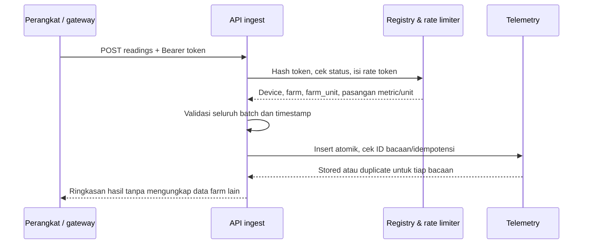

# P3-01 — Registry Perangkat dan Ingest Telemetry

**Status:** Disetujui untuk perencanaan pada 2026-10-02; belum diimplementasikan  
**Tanggal:** 2026-10-01; persetujuan baseline: 2026-10-02

## Tujuan

Menambahkan registry perangkat sensor per farm dan endpoint ingest netral-protokol
yang menerima bacaan terdaftar. Bacaan harus dapat ditelusuri ke farm, unit fisik,
perangkat, metric, unit ukur, waktu observasi, waktu penerimaan, dan kualitasnya.
Subsystem ini hanya mencatat telemetry. Ia tidak mengubah stok, biaya, HPP, jadwal,
ledger, atau kontrol perangkat.

## Baseline yang disetujui

- Semua anggota farm yang aktif dapat melihat dan mengelola perangkat di farm itu.
  Tidak ada role operasional baru; aturan Owner untuk menambah atau mengeluarkan
  anggota tidak berubah.
- Setiap perangkat memakai token acak 256-bit. Database hanya menyimpan hash
  SHA-256 token; nilai mentah ditampilkan satu kali saat perangkat dibuat atau
  token dirotasi.
- Ingest menerima ID bacaan idempoten dan hanya pasangan metric/unit yang terdaftar
  pada perangkat. Farm dan unit fisik ditentukan dari registry token, bukan payload.
- Bacaan append-only. Bacaan terlambat tetap disimpan sebagai observasi historis,
  bukan menimpa bacaan lain.
- Batas awal: timestamp paling jauh 5 menit ke depan, usia `observed_at` maksimal
  90 hari, retensi bacaan 90 hari, 120 request per menit per perangkat, maksimal
  100 bacaan per request.
- Tidak ada klaim kompatibilitas hardware, vendor, atau protokol tertentu.

## Keputusan desain yang disetujui untuk implementasi

1. Gunakan `Authorization: Bearer` pada endpoint ingest; jangan menaruh token di
   URL, cookie, query string, atau payload bacaan.
2. Jika request manajemen diulang dengan idempotency key yang sama, receipt hanya
   memuat metadata nonrahasia. Replay tidak menampilkan token. Jika respons pertama
   hilang, anggota harus merotasi token dengan key baru.
3. Token bucket rate limiter disimpan di PostgreSQL: kapasitas 120 token, pulih
   2 token per detik. Ini menerapkan rata-rata 120 request/menit dengan burst
   maksimum 120, tetap konsisten di restart dan beberapa proses.
4. Nilai dikirim sebagai string desimal, maksimum 12 digit sebelum dan 6 digit
   sesudah titik (`numeric(18,6)`). Kualitas memakai enum `GOOD`, `SUSPECT`,
   `INVALID`; bila tidak dikirim, nilainya `GOOD`.
5. Binding perangkat ke farm dan unit fisik tetap selama umur registry. Pemindahan
   fisik dicatat dengan membuat registry baru untuk unit tujuan dan mencabut yang
   lama. Ini menjaga asal-usul bacaan lama tanpa histori binding tambahan.
6. Perangkat yang dicabut tidak dapat diaktifkan kembali; anggota membuat registry
   baru bila perangkat perlu dipakai kembali. Rotasi token pada perangkat aktif
   langsung membatalkan token lama.

## Batas lingkup

### Termasuk

- Registry perangkat farm: buat, lihat, ubah nama, kelola pasangan metric/unit,
  rotasi token, dan cabut perangkat.
- Endpoint ingest batch netral-protokol dengan validasi, idempotensi, timestamp,
  pembatasan laju, dan respons per bacaan.
- Penyimpanan bacaan, query halaman registry termasuk waktu penerimaan terakhir,
  dan penghapusan bacaan kedaluwarsa.
- UI registry sederhana yang mengikuti shell dan pola halaman farm OpSmart.

### Tidak termasuk

- Driver, adapter, discovery, provisioning, atau klaim dukungan perangkat/vendor/
  protokol tertentu.
- Grafik telemetry, threshold, deteksi kondisi abnormal, notifikasi, dashboard
  sensor, atau refresh near-real-time; itu bagian desain P3-02 setelah threshold
  dan aturan staleness disetujui.
- Konversi unit, katalog agronomis metric, penggabungan bacaan lintas unit, prediksi,
  AI/RAG, kontrol aktuator, atau tindakan otomatis.
- Perubahan pada domain cycle, jadwal, persediaan, biaya, HPP, atau ledger.

## Arsitektur

Perangkat mengirim batch ke satu endpoint HTTPS yang netral terhadap protokol.
Route ini memakai autentikasi token perangkat dan dipasang terpisah dari middleware
session/CSRF browser. Route manajemen memakai session lokal, pemeriksaan Origin dan
CSRF, keanggotaan farm, lalu command transaksional yang sudah digunakan modul lain.
Route ingest dipasang sebelum parser JSON umum dan memakai parser route khusus dengan
batas 128 KiB. Limit parser umum 100 KB untuk endpoint lain tetap berlaku.



Ingest tidak memakai lock farm. Transaksi perangkat mengunci baris perangkat untuk
rate limiting dan memeriksa status/hash token sekali lagi ketika menyimpan bacaan.
Semua bacaan dalam satu batch disimpan atomik: jika ada ID yang sama dengan payload
berbeda atau ada kegagalan validasi, tidak ada bacaan batch yang baru tersimpan.

## Kontrak HTTP

### Manajemen perangkat

Route berada di `/api/farms/:farmId/devices` dan memakai session anggota farm.

| Operasi       | Endpoint                                                 | Ringkasan                                                                           |
| ------------- | -------------------------------------------------------- | ----------------------------------------------------------------------------------- |
| Daftar        | `GET /api/farms/:farmId/devices`                         | Halaman registry, status, unit fisik, konfigurasi metric, dan `last_received_at`    |
| Buat          | `POST /api/farms/:farmId/devices`                        | Nama, `farm_unit_id`, dan daftar metric/unit; respons awal menyertakan token sekali |
| Ubah nama     | `PATCH /api/farms/:farmId/devices/:deviceId`             | Mengubah label saja                                                                 |
| Kelola metric | `PUT /api/farms/:farmId/devices/:deviceId/metrics`       | Mengaktifkan/nonaktifkan pasangan metric/unit; bacaan historis tetap utuh           |
| Rotasi token  | `POST /api/farms/:farmId/devices/:deviceId/token/rotate` | Mengganti token secara atomik dan mengembalikan token baru sekali                   |
| Cabut         | `POST /api/farms/:farmId/devices/:deviceId/revoke`       | Membatalkan token dan menghentikan ingest                                           |

Semua mutasi browser mensyaratkan `Idempotency-Key`. Perangkat/unit tujuan harus
berasal dari `farmId` yang sama. `farm_unit_id` tidak dapat diubah setelah registry
dibuat. Daftar menggunakan cursor, 50 baris default dan 100 maksimum. Token hash
tidak pernah disertakan pada DTO.

### Ingest bacaan

`POST /api/iot/v1/readings` menerima:

```json
{
  "readings": [
    {
      "reading_id": "gateway-7:98211",
      "metric": "water_temperature",
      "unit": "degC",
      "value": "24.125",
      "observed_at": "2026-10-01T09:00:00+07:00",
      "quality": "GOOD"
    }
  ]
}
```

`reading_id` adalah string ASCII 1–128 karakter dari `[A-Za-z0-9._:-]`; perangkat
tidak boleh menggunakannya ulang. Keunikan yang ditegakkan server berlaku selama
baris bacaan masih berada dalam masa retensi. `metric` harus berupa snake_case ASCII
1–64 karakter yang diawali huruf kecil (`[a-z][a-z0-9_]{0,63}`). `unit` adalah
identifier ASCII 1–32 karakter, diawali alfanumerik dan selanjutnya hanya
alfanumerik, titik, garis bawah, garis miring, persen, atau tanda hubung
(`[A-Za-z0-9][A-Za-z0-9._/%-]{0,31}`). Keduanya harus sama persis dengan pasangan
aktif yang didaftarkan. `value` harus cocok dengan
`^-?(0|[1-9][0-9]{0,11})(\.[0-9]{1,6})?$`.
`observed_at` harus ISO-8601 dengan offset atau `Z`. `quality` opsional dan hanya
menerima tiga nilai enum yang disebut di atas. `received_at` dibuat server saat
insert; payload tidak boleh memasok farm, unit fisik, device ID, atau `received_at`.

Batas body adalah 128 KiB. Batas jumlah bacaan 1–100. Respons `200` berisi jumlah
`stored` dan `duplicate`, ditambah hasil berurutan menurut input (`reading_id` dan
status `stored` atau `duplicate`). Retry identik aman. ID yang sama dengan payload
kanonis yang berbeda menghasilkan `409 CONFLICT`. Request melebihi rate limit
menghasilkan `429` dengan `Retry-After`; token hilang/tidak sah/dicabut menghasilkan
`401` tanpa membedakan sebabnya. Error memakai envelope API yang sudah ada,
`{error:{code,message}}`. Metric/unit yang tidak terdaftar, format payload,
presisi, atau timestamp yang tidak sah menghasilkan `422`.

## Semantik waktu, kualitas, dan idempotensi

- Waktu dinormalisasi sebagai instant PostgreSQL `timestamptz`; offset asli tidak
  diperlukan untuk membandingkan bacaan.
- Batas timestamp dihitung terhadap satu nilai jam database yang diambil saat
  validasi batch: `observed_at <= now + 5 menit` dan
  `observed_at >= now - 90 hari`. Kedua batas inklusif.
- `received_at` dibuat database-side pada saat insert, satu nilai per baris.
- Bacaan dengan kualitas `INVALID` tetap disimpan untuk audit perangkat, tetapi
  tidak dianggap bacaan terkini yang dapat ditampilkan oleh query operasional.
  `GOOD` dan `SUSPECT` tetap dapat dibaca dengan label kualitas aslinya.
- Identitas idempoten selama retensi adalah `(device_id, reading_id)`; perangkat
  tetap diwajibkan tidak menggunakan ID kembali setelah purge. Perbandingan replay
  memakai payload kanonis: metric, unit, nilai desimal ternormalisasi, instant
  observed, dan quality. Seluruh batch rollback bila salah satu ID berkonflik.
- Penyimpanan append-only berarti insert saja selama retensi. Bacaan lama tidak
  memperbarui bacaan lain. Jika dibutuhkan query bacaan terkini, urutkan per pasangan
  farm/unit/metric/unit ukur dengan `observed_at DESC`, `received_at DESC`, lalu
  ID internal sebagai tie-break. P3-02 dapat membangun view waktu nyata di atas
  kontrak ini.

## Model data

Migration berikutnya adalah `014_iot_telemetry.sql`.

### `farm_device`

- `id`, `farm_id`, `farm_unit_id`, label, `token_hash`, status (`ACTIVE`/`REVOKED`),
  waktu dan actor pembuatan/perubahan/pencabutan.
- Kolom token bucket: token tersisa dan waktu refill terakhir. Kapasitas 120,
  refill 2 token per detik, tidak dapat melebihi kapasitas.
- Unique token hash dan key komposit `(id, farm_id, farm_unit_id)` untuk FK bacaan.
- FK komposit farm/unit memastikan perangkat tidak terikat ke unit farm lain.

### `farm_device_metric`

- Key `(device_id, metric_key, measurement_unit)`; metric dan unit disimpan sebagai
  identifier pendek ternormalisasi, tanpa interpretasi atau konversi global.
- Status aktif/nonaktif, actor dan waktu perubahan. Menonaktifkan pasangan
  menghentikan ingest pasangan itu; histori bacaan tidak diubah.

### `telemetry_reading`

- ID internal, device, farm, farm unit, `reading_id`, metric, unit ukur, nilai,
  `observed_at`, `received_at`, quality.
- Unique `(device_id, reading_id)` untuk idempotensi.
- FK komposit ke binding perangkat menjaga farm/unit bacaan sama dengan registry.
- Index lookup latest menggunakan `(farm_id, farm_unit_id, metric_key,
measurement_unit, observed_at DESC, received_at DESC)` dan index `received_at`
  untuk retensi.
- FK ke pasangan metric/unit terdaftar menjaga bacaan tetap punya konfigurasi asal;
  baris konfigurasi yang retired tidak dihapus.
- Runtime role mendapat SELECT/INSERT; UPDATE/DELETE dicabut. Penghapusan retensi
  dilakukan hanya lewat fungsi DB `SECURITY DEFINER` milik role migrator dengan
  `search_path` tetap, validasi batas batch 1–1.000, dan predicate tunggal
  `received_at < clock_timestamp() - interval '90 days'`. Runtime hanya mendapat
  izin `EXECUTE` fungsi tersebut, bukan hak DELETE tabel. Cabut `EXECUTE` default
  dari `PUBLIC` sebelum memberi izin hanya ke runtime role.

### `farm_device_event`

Append-only audit untuk `CREATED`, `RENAMED`, `METRIC_ACTIVATED`, `METRIC_RETIRED`,
`TOKEN_ROTATED`, dan `REVOKED`, dengan device, farm, actor, waktu, dan metadata
perubahan nonrahasia. Nilai token mentah tidak pernah menjadi metadata event.
Runtime role mendapat SELECT/INSERT saja.

## Siklus secret dan keamanan

- Token dibuat dengan CSPRNG 32 byte lalu dikodekan base64url; hash SHA-256 unik
  disimpan. Kesamaan SHA-256 cukup untuk token berentropi tinggi ini.
- Buat/rotasi berjalan dalam transaksi device. Rotasi menyimpan hash baru dan event
  audit sebelum commit; hash lama tidak lagi terautentikasi setelah commit.
- Command receipt menyimpan hanya ID perangkat, status, dan metadata nonrahasia.
  Helper command memisahkan hasil respons sekali-pakai dari nilai yang diserialisasi
  ke receipt. Nilai token dikembalikan dari hasil eksekusi pertama tetapi tidak
  pernah diserialisasi; replay key yang sama tidak mengembalikan secret.
- Respons create/rotate memakai `Cache-Control: no-store`. UI menampilkan token
  sekali dengan tindakan salin dan petunjuk konfigurasi; token tidak disimpan di
  localStorage, state persisten, analytic event, error, request log, atau URL.
- Ingest memakai HTTPS di deployment, membandingkan hash token, menggunakan query
  parameter SQL, membatasi body, serta tidak mencatat header `Authorization` atau
  body bacaan. Kesalahan tidak mengungkap farm/unit atau status token.
- Status token dicek lagi di transaksi insert. Pencabutan dan ingest yang berlomba
  menghasilkan salah satu hasil konsisten: bacaan commit sebelum pencabutan, atau
  ingest ditolak setelah pencabutan.

## UI

Tambahkan halaman `/devices` pada farm aktif dengan pola shell OpSmart: breadcrumb,
judul, status kosong/error/loading, tombol tambah, tabel/kartu responsif, serta form
create/edit. Halaman menampilkan nama, unit fisik, status, pasangan metric/unit,
dan waktu bacaan terakhir. Token mentah hanya ada pada dialog sukses create/rotate
dan hilang ketika dialog ditutup atau berpindah halaman. Dialog revoke menjelaskan
bahwa ingest berhenti dan data historis tetap ada.

Halaman ini tidak memuat grafik, threshold, alert, atau kontrol hardware. Kegagalan
API menampilkan error aman dan retry; semua data datang dari DTO API farm-scoped.

## Validasi, transaksi, dan kegagalan

- Mutasi registry memakai helper `command()` dengan lock farm, verifikasi membership,
  pemeriksaan archived farm, idempotency receipt dan rollback yang sudah dipakai
  aplikasi. Pemeriksaan farm/unit/device tetap eksplisit.
- Create token, rotasi, pencabutan, perubahan label, dan perubahan metric dicatat
  actor beserta waktu dalam transaksi. Tidak ada secret pada receipt.
- Rate limiter memakai transaksi atomik terpisah yang mengunci baris device dan
  commit konsumsi token sebelum keputusan ingest. Request yang kemudian gagal
  validasi tetap dihitung setelah token perangkat berhasil diautentikasi.
- Ingest memvalidasi ukuran/bentuk batch, batas rate, status token, binding registry,
  pasangan metric/unit, nilai desimal, quality, dan waktu sebelum insert.
- Pelanggaran constraint atau kegagalan DB menjadi error API umum; jangan mengirim
  SQL, hash, token, atau data farm lain ke pemanggil.
- Cleanup retensi berjalan harian dan mengulang fungsi DB per batch hingga tak ada
  bacaan kedaluwarsa yang tersisa. Pemanggilan berulang aman setelah restart.

## Acceptance criteria

1. Anggota farm aktif dapat mendaftarkan perangkat pada unit farmnya; pengguna tanpa
   membership dan ID dari farm lain ditolak tanpa kebocoran detail.
2. Token mentah hanya dikembalikan pada respons pertama create/rotate; token lama
   langsung ditolak setelah rotasi dan token ditolak setelah pencabutan.
3. Secret/hash tidak muncul di DTO list/detail, receipt, event audit, error, atau log.
4. Ingest hanya dapat menulis melalui registry token, dan farm/unit di DB berasal
   dari registry, bukan field yang dapat dipalsukan pada payload.
5. Metric/unit yang tidak didaftarkan, value di luar presisi, quality tak dikenal,
   batch kosong/lebih dari 100, payload di atas 128 KiB, timestamp terlalu lama,
   atau lebih dari lima menit ke depan ditolak.
6. Replay `(device_id, reading_id)` dengan payload sama mengembalikan duplicate
   tanpa row tambahan; payload berbeda menghasilkan conflict; batch gagal tidak
   meninggalkan bacaan baru parsial.
7. Bacaan terlambat tersimpan dan tidak mengganti bacaan lain. Query latest memilih
   bacaan valid berdasarkan urutan waktu yang ditetapkan, bukan urutan kedatangan.
8. Rate limiter membatasi satu perangkat tanpa membatasi perangkat lain, konsisten
   pada request concurrent dan restart proses; `Retry-After` menyatakan waktu tunggu.
9. Penghapusan retensi menghapus berdasarkan `received_at` di luar 90 hari tanpa
   memberi endpoint aplikasi kewenangan menghapus sembarang bacaan.
10. Ingest tidak menulis ke farm ledger, inventory movement, biaya, HPP, atau command
    budidaya; runtime grants menolak update bacaan.

## Verifikasi implementasi yang diwajibkan

- Unit/contract: token generation/hash, validasi schema/decimal/time, quality,
  canonical payload, dan response redaction.
- API: anggota/nonanggota, farm/unit silang, token invalid/rotated/revoked, CSRF
  management, Bearer ingest, batas batch/body, serta error shape.
- Database (PGlite): migration fresh, constraints/FK, idempotent insert/replay,
  transaction rollback untuk konflik campuran, append-only grants, serta retention.
- PostgreSQL multi-connection: ingest identik bersamaan hanya menyimpan satu bacaan;
  ID konflik tidak menyimpan batch parsial; rate limiter concurrent mematuhi burst
  dan refill; revoke/ingest concurrent menghasilkan batas urutan yang konsisten.
- UI: status loading/error/empty, create, token one-time, copy, edit config, rotate,
  revoke, responsif, serta isolasi farm aktif.
- Jalankan suite lengkap, build/typecheck, dan format check sebelum menandai P3-01
  selesai. Pemeriksaan hardware/protokol vendor tidak menjadi kriteria task ini.

## Hubungan dengan task lain

- P3-02 menggunakan pembacaan telemetry ini untuk tampilan dan alert setelah threshold,
  stale timeout, dedupe/hysteresis, dan refresh policy ditetapkan.
- P3-03/RAG tidak mengindeks stream sensor; fakta telemetry dibaca melalui query
  operasional terbaru jika kelak masuk kontrak jawaban yang disetujui.
- Device secret mengotorisasi write telemetry saja, tidak memberikan session browser
  atau akses baca farm.
